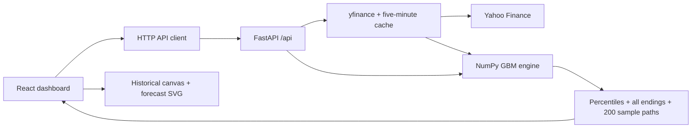

# MonteCarl0

[](https://github.com/UhhSaif/MonteCarl0/actions/workflows/ci.yml)

**An interactive market-research workspace that makes uncertainty visible.** Search stocks, explore adjusted price history, and simulate up to 10,000 possible futures with a custom forecast fan and sideways ending-price histogram.

React 19 · FastAPI · NumPy · TradingView Lightweight Charts · custom SVG · Docker

The roulette-inspired interface is decorative; the statistical engine uses historically calibrated geometric Brownian motion. No accounts, trading, or AI forecasting are included.

**Project evidence:** [synthetic validation and benchmarks](docs/validation-report.md) · [real-market held-out evaluation](docs/validation-market-report.md) · [deployment guide](docs/deployment.md)

**Public demo:** deployment configuration is ready; a verified public URL is not yet available. Run locally using the instructions below.

## Architecture



In development, Vite proxies API calls to Python. In the deployment image, FastAPI serves the compiled frontend and API from the same origin.

## Engineering decisions

- All trials contribute to statistics; only 200 individual paths are transferred for display.
- Model computation and animation are separate. Replay and target exploration reuse completed results.
- Abortable browser requests prevent stale selections from overwriting new data.
- Input bounds, finite-value checks, provider error handling, and caching keep failures explicit.
- CI runs offline tests, builds the frontend and Docker image, and uploads a fresh synthetic validation report.
- Rolling validation fits only on data available through each forecast origin, with a test that perturbs future prices to check isolation.

## Run locally

Prerequisites: Python 3.11+ and Node.js 22.12+ (Node 24 LTS recommended).

From the repository root, start the API in one terminal:

```bash
python3 -m venv .venv
source .venv/bin/activate
python -m pip install -r backend/requirements.txt
python -m uvicorn backend.main:app --reload --host 127.0.0.1 --port 8000
```

In a second terminal:

```bash
cd frontend
npm ci
npm run dev
```

Open **http://127.0.0.1:5173**. API documentation is at **http://127.0.0.1:8000/docs**. Stop either server with Ctrl+C. No API keys are required. Internet access is required for Yahoo Finance data.

For the versions used during development, `backend/requirements-lock.txt` records a full Python dependency snapshot; install it instead of `requirements.txt` for that exact set. The npm lockfile pins frontend dependencies.

## Run a Monte Carlo simulation

Below the historical chart, choose the trial count, trading-day horizon, and
historical estimation window, then click **Run Monte Carlo**. A fixed seed replays
the same random draws for the same historical input; leave it blank for a new seed.

- Green shows prices above the starting close; red shows prices below it.
- Stronger shading marks the middle 50% inside the lighter 90% percentile band.
- The gold median and dashed 25th/75th percentile lines summarize the distribution.
- The sideways histogram shares the forecast's price axis; wider bars mean more endings.
- Pause, resume, show all, or replay the visualization without another API call.
- Change the target input/slider, or inspect and click the histogram, to explore probabilities without rerunning.

The progress bar represents **visualization progress**, not backend computation.
Live probabilities use the revealed endings; percentile bands use the completed
model. Reduced-motion preferences skip the reveal. On phones, swipe the chart
horizontally to see its right-hand distribution. Results are model-based estimates,
not predictions or investment recommendations.

## How the pieces connect

1. `frontend/src/components/StockSearch.jsx` debounces company/ticker searches by 300 ms. Arrow keys navigate, Enter selects/searches, and Escape dismisses suggestions.
2. `frontend/src/App.jsx` owns the selected ticker and timeframe. It requests history and cancels obsolete requests so a slow response cannot replace a newer selection.
3. `frontend/src/services/stockApi.js` calls the FastAPI endpoints. Vite proxies `/api` to port 8000 during development.
4. `backend/main.py` defines HTTP routes and maps errors to consistent `{ "detail": "..." }` responses. Synchronous routes run provider work in FastAPI's thread pool.
5. `backend/services/market_data.py` calls yfinance, validates symbols, normalizes data, filters unfinished sessions, and caches successful responses for five minutes (up to 128 entries per process).
6. `StockHeader.jsx` displays the latest completed session and change from the preceding session. `StockChart.jsx` owns the TradingView chart and removes it on cleanup. `TimeframeSelector.jsx` changes the history window.

The history response includes lightweight metadata from the same provider request, so loading a chart does not also require an expensive company `.info` call. `/api/stocks/{ticker}` remains available for independent metadata consumers.

## API

| Endpoint | Purpose |
| --- | --- |
| `GET /api/health` | Application health (does not test Yahoo connectivity) |
| `GET /api/search?q=Apple` | Provider-backed equity/ETF search; empty query/no matches returns `[]` |
| `GET /api/stocks/AAPL` | Symbol, name, exchange, currency when available |
| `GET /api/stocks/AAPL/history?period=1y` | Chronological OHLCV, metadata, latest close and session change |
| `POST /api/simulations/monte-carlo` | Historically calibrated GBM trials, ending distribution, percentiles, and empirical probabilities |

Historical API periods: `1mo`, `3mo`, `6mo`, `1y`, `3y`, `5y`, `max`. Invalid input returns 400/422, missing history 404, provider failures 502, and rate limiting 503. Missing optional values are JSON `null`, never NaN. Invalid OHLC bars are omitted, dates are sorted and deduplicated.

See [the Monte Carlo engine/API guide](docs/monte-carlo.md) for request examples, the daily GBM equation, response fields, reproducibility, limits, and testing. To run the live NVDA example and save its input/output: `.venv/bin/python -m backend.demo_monte_carlo`.

## Price semantics and limitations

- `auto_adjust=True`: OHLC values are adjusted for splits and dividends. The displayed close is an adjusted historical close, not a live quote or necessarily the original unadjusted closing print. Volume is provider-reported volume.
- The change is the difference between the last two valid completed sessions in the returned history. If only one bar exists, change is unavailable. It is not the return over the entire selected timeframe.
- Current-day bars are included only when provider session metadata confirms the regular session ended at least 15 minutes ago. Otherwise today's bar is conservatively omitted in the exchange timezone (UTC if unknown). Missing/stale session metadata may delay the displayed close until the following day. The actual bar date is always shown.
- Yahoo Finance/yfinance is an unofficial, best-effort source. Outages, throttling, delayed values, missing metadata, and incomplete histories are possible. Errors are shown with a retry action; sample prices are never substituted.
- Search results are limited to eight provider results, filtered to stocks and ETFs. Direct ticker entry also supports common Yahoo symbol punctuation. Data availability varies across exchanges and instruments.
- Local educational use only. Review Yahoo Finance's applicable data-use terms before redistributing or deploying publicly. This is not investment advice.
- Caching is in-memory and resets when the API restarts. No automatic polling or streaming is implemented.
- The layout responds to mobile widths; the canvas chart includes a text summary for assistive technology, but does not expose every data point as a keyboard-accessible table.

## Configuration

Defaults work without environment files. See `frontend/.env.example` and `backend/.env.example`.

- `API_PROXY_TARGET`: backend URL used by Vite's development proxy.
- `VITE_API_BASE_URL`: optional absolute backend URL when deploying the frontend separately (omit `/api`). Restart/rebuild the frontend after changes.
- `CORS_ORIGINS`: comma-separated allowed frontend origins; defaults to localhost and 127.0.0.1 on port 5173. Export it before starting Uvicorn. Backend `.env` files are not loaded automatically.

`npm run preview` serves the production assets without Vite's development proxy. For a separate production preview, set `VITE_API_BASE_URL`, allow the preview origin through `CORS_ORIGINS`, and rebuild; alternatively place both services behind a reverse proxy that forwards `/api`.

## Checks

From the repository root:

```bash
.venv/bin/python -m pytest backend/tests -q
cd frontend
npm run build
npm test
```

Backend tests mock Yahoo to cover all supported historical periods, validation, no data, provider outages, rate limiting, search filtering, metadata reuse, cache behavior, NaN/Infinity cleaning, date ordering, duplicate sessions, close-time filtering, and session-change calculations. They run without network access.

Manual browser checklist: initial AAPL load; search a company; select a result with arrow keys + Enter; Escape dismissal; direct ticker entry; all timeframe buttons; crosshair/zoom/scroll; invalid ticker; retry; narrow viewport; rapidly switch stocks/timeframes.

## Validation and deployment

Run `python -m backend.validate_model` to reproduce the offline synthetic report. Use `--ticker AAPL --output docs/validation-market-report.md` for current five-year market history. Market reports depend on retrieval date and adjusted-data revisions; synthetic tests require no network. See the reports for methodology and limitations.

See [deployment instructions](docs/deployment.md) for the free Render configuration. Public availability and successful GitHub Actions runs must be verified after pushing and connecting hosting.

## Attribution

TradingView Lightweight Charts™
Copyright (с) 2025 TradingView, Inc. https://www.tradingview.com/

Lightweight Charts is licensed under Apache 2.0. The app includes the TradingView attribution link/logo and visible notice. See `THIRD_PARTY_NOTICES.md` and the dependency's distributed license.
